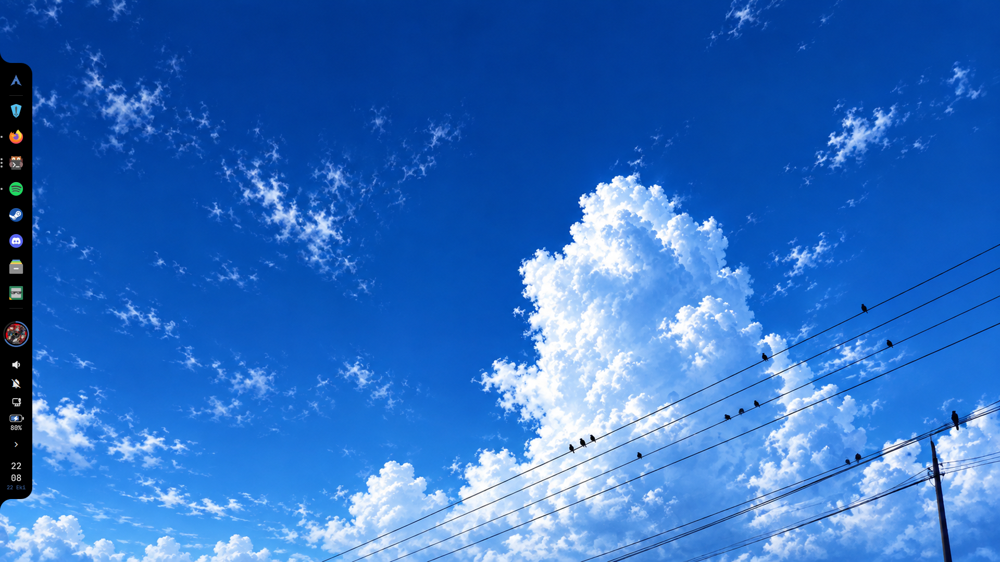
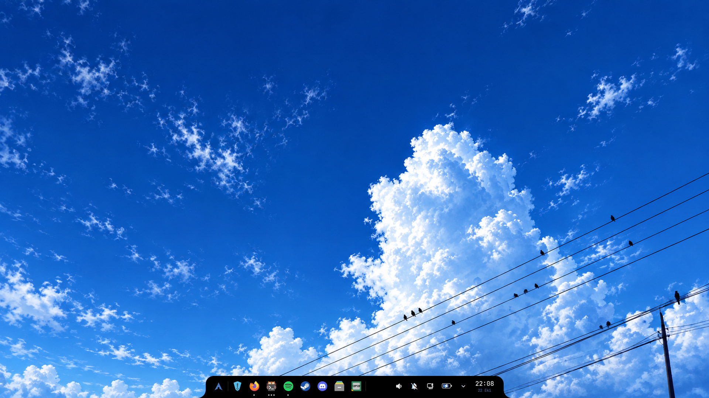

# LeyzS QsDock

A morphing dock for **Hyprland**, built with **Quickshell** and colored by **pywal**.

The dock hides on the left edge of the screen. Click something on it and the dock itself
stretches into a panel: wallpapers, apps, network, notifications, battery, sound, a system
dashboard. Double-click the Arch icon and it slides down and lies flat along the bottom of
the screen. Every accent color comes from your wallpaper.

<p align="center">
  
  
</p>

## Features

- **Vertical or horizontal:** double-click the Arch icon to switch. Choose auto-hide or always visible.
- **Pinned apps and open windows:** right-click an app to pin or unpin it, open a new window or close all of its windows.
- **App launcher** with search.
- **Wallpaper picker** with thumbnails. It runs your own script, or falls back to awww/swww + pywal.
- **Network panel:** Wi-Fi (connect, password, forget) and Bluetooth (pair, connect, battery).
- **Notifications:** a full notification center, popups that come out of the dock, do not disturb and an optional sound.
- **Battery panel:** remaining time, health, temperature, power profiles (power-profiles-daemon) and the apps using the most power.
- **Sound panel:** outputs, inputs and per-app volume (PipeWire).
- **System dashboard:** CPU, RAM, disk, NVIDIA GPU, uptime, top processes, and lock / sleep / logout / reboot / shutdown.
- **Media:** the player follows MPRIS, so Spotify and browsers both work.
- **Prayer times** (off by default): click the clock to see them. They come from the Aladhan API for the cities you list.
- **English and Turkish interface.**

## Dependencies

Arch package names:

| Needed for | Packages |
|---|---|
| Core | `quickshell` (or `quickshell-git`), `hyprland`, `qt6-5compat`, `python-pywal` (or `pywal16`) |
| Fonts / icons | `ttf-jetbrains-mono-nerd`, `ttf-nerd-fonts-symbols`, `inter-font`, `papirus-icon-theme` |
| Network | `networkmanager`, `bluez`, `bluez-utils` |
| Battery | `upower`, `power-profiles-daemon` |
| Sound | `pipewire`, `wireplumber` |
| Optional | `hyprlock` (lock button), `nvidia-utils` (GPU stats), `awww` or `swww` (wallpapers), `curl` (prayer times) |

## Install

```sh
git clone https://github.com/L3yzs/LeyzS-QsDock
cd LeyzS-QsDock
bash install.sh            # English
bash install.sh --lang tr  # Türkçe
```

The installer copies the configs to `~/.config/quickshell/`. If you already have folders
with the same names, it renames them to `*.backup-<date>` first. Then add this to your
Hyprland autostart:

```lua
-- hyprland.lua
hl.exec_cmd("qs -c dock -d")
hl.exec_cmd("qs -c notifications -d")   -- notification daemon
hl.exec_cmd("qs -c wifi-panel -d")
```

```ini
# hyprland.conf
exec-once = qs -c dock -d
exec-once = qs -c notifications -d
exec-once = qs -c wifi-panel -d
```

Only one notification daemon can run at a time, so stop mako, dunst or swaync first.

## Settings

Edit `~/.config/quickshell/settings.json`. Changes apply right away.

```json
{
  "lang": "en",
  "name": "",
  "avatar": "",
  "dockOutputs": [],
  "wallpaperDir": "~/Pictures/Wallpapers",
  "wallpaperScript": "",
  "prayer": { "enabled": false, "country": "Turkey", "method": 13, "cities": ["Istanbul"] }
}
```

| Key | What it does |
|---|---|
| `lang` | `"en"` or `"tr"` |
| `name` | Name shown on the dashboard and menus. Empty means your login name. |
| `avatar` | Picture or GIF for the app menu. Empty means `~/.face`. |
| `dockOutputs` | Monitors to show the dock on, e.g. `["DP-1"]`. Empty means every monitor. Run `hyprctl monitors` to see the names. |
| `wallpaperDir` | Folder the wallpaper picker reads. |
| `wallpaperScript` | Your own script, called as `script /path/to/image`. Empty means `awww img` / `swww img` + `wal -i`. |
| `prayer` | Prayer times. Set `"enabled": true` to turn them on. `cities` can be plain names (`"Berlin"`) or `{"name": "İstanbul", "api": "Istanbul"}`. For `method`, see the [Aladhan docs](https://aladhan.com/calculation-methods). |

**Pinned (always visible) mode:** to stop windows from going under the dock, `dock-reserve`
edits the `reserved_area` line in your Hyprland Lua monitor config. Point it at that file:
`export DOCK_MONITORS_LUA=~/.config/hypr/monitors.lua`. If the file doesn't exist, it does nothing.

## Keybinds

Everything can be opened over IPC:

```sh
qs -c dock ipc call dock apps     # app launcher
qs -c dock ipc call dock walls    # wallpapers
qs -c dock ipc call dock net      # Wi-Fi / Bluetooth
qs -c dock ipc call dock notif    # notifications
qs -c dock ipc call dock bat      # battery
qs -c dock ipc call dock audio    # sound
qs -c dock ipc call dock dash     # system dashboard
qs -c dock ipc call dock ezan     # prayer times (if enabled)
qs -c dock ipc call dock yon      # vertical <-> horizontal
qs -c dock ipc call dock toggle   # show / hide
qs -c notifications ipc call notifcenter toggleDnd
```

```lua
-- example: hyprland.lua
hl.bind("SUPER + A", hl.dsp.exec_cmd("qs -c dock ipc call dock apps"))
```

## Notes

- **Notification sound:** put your own `bildirim.mp3` in `~/.config/quickshell/dock/`. If there is no file, the dock stays silent.
- **Battery panel:** "Conservation mode" only appears on laptops that report it, such as Lenovo laptops.
- **Spotify playlist:** the playlist name in the media player comes from a small Spicetify extension that isn't included here. Everything else in the player works without it.
- **Code comments** are in Turkish (sorry!). Everything you see on screen is in English.

## License

MIT, made by **LeyzS**.
